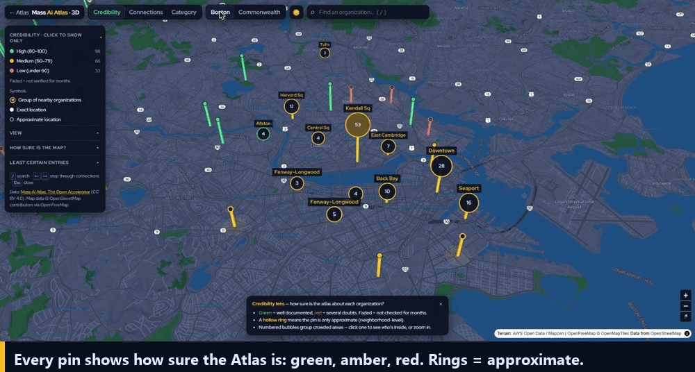

# 🏙️ 3D Lenses — a map of Massachusetts AI that says how sure it is

**Team CommonSpace** · [Chart the Common Wealth](https://the-open-accelerator.com/hackathon/upcoming/Chart-the-Common-Wealth/) hackathon, 31 Oct 2026 · Track B, "The Passage"

[](https://egornikot.github.io/mass-ai-atlas/atlas3d.html)
[](https://github.com/holzerjm/mass-ai-atlas/pull/79)
[](docs/3d-lenses.md)

[](https://egornikot.github.io/mass-ai-atlas/atlas3d.html)

Built on the [Mass AI Atlas](https://the-open-accelerator.com/ecosystem/) by The Open Accelerator.
This repository is a fork of [holzerjm/mass-ai-atlas](https://github.com/holzerjm/mass-ai-atlas); the
original README is kept in [docs/ATLAS-README.md](docs/ATLAS-README.md).

---

## The problem

The Atlas already records its own doubt. Each entry can carry approximate coordinates, a
verification month, missing founder stages, missing links, a funder with no check size, or a
deadline that only says "rolling". **None of it reached the map.** A neighborhood guess looked
exactly like a street address. The connections lived only in the Galaxy view, away from the
geography. A founder planning a walk between three Kendall labs was reading an estimate drawn
as a fact.

## What we built

| | |
|---|---|
| 🟢🟡🔴 **Credibility lens** | Every pin is green, amber or red, from a 0–100 reading of the brief's **six doubt signals**: approximate pin, verification month, no stage, no connections, funder with no check size, and a deadline that is rolling, dated or passed. We also found and added two more: pins that share exact coordinates, and links listed by one side only. Approximate pins are hollow rings with a halo, and older entries fade. |
| ⚠️ **"Before you act"** | Each card opens with what to double-check, for example *"Get the street address from their site before you plan a visit"* or *"Ask about their typical check before you pitch"*. |
| 🔗 **A source for every claim** | Every signal links to **the exact line** in [`data/entities.yml`](data/entities.yml) that supports it, so a judge can click any claim and check it. |
| 🕸️ **Connections on the real map** | The Galaxy's links are drawn as arcs and bundled between areas, so a crowd sends one thick arc instead of forty. Selecting an organization shows only its network; ← → walks through it. |
| 🏙️ **3D across the Commonwealth** | Tilt and rotate the map. Columns show credibility or connections, buildings appear at street zoom, and hillshade gives relief from the Berkshires to the Cape. |
| 🧭 **Readable, not crowded** | Dense areas group into bubbles named after their neighborhood (Kendall Sq, Seaport…) that split as you zoom. Labels never overlap. The legend is a show-only filter, and each lens has a short reading guide. |
| 🌗 **Day / night** | One button, with bluish water and green parks in both themes. |
| ⌨️ **Keyboard & phone** | `/` search, ← → through a network, `Esc` to close. The panel folds on small screens, and reduced motion is respected. |

## Why it matters

- **Founders** know *before* they act which parts of an entry to double-check. The confident
  entries stay confident; the doubtful ones say what is doubtful and what to do next.
- **The maintainer** gets a review queue: "Least certain entries" lists the weakest entries
  first, and "Suggest a fix" opens the Atlas's existing flag form. Nothing is written to the
  data without a human.
- **The Atlas** gets this morning's probe numbers counted live in the side panel and drawn on
  the map. There is no build step and no new data.

## Try it in 30 seconds

1. Open the **[live demo](https://egornikot.github.io/mass-ai-atlas/atlas3d.html)** and click the **Kendall Sq** bubble.
2. Open a doubtful entry: **[Liquid AI](https://egornikot.github.io/mass-ai-atlas/atlas3d.html?entry=liquid)**
   (approximate pin, shared coordinates, no stage) or
   **[ConcertAI](https://egornikot.github.io/mass-ai-atlas/atlas3d.html?entry=concertai)**. Then click any **source ↗**.
3. Compare a confident one: **[MIT CSAIL](https://egornikot.github.io/mass-ai-atlas/atlas3d.html?entry=csail)**.
4. Switch to **Connections**, then **Commonwealth**, and press ☀️ for the day map.

Any entry opens directly with `atlas3d.html?entry=<id>`.

## What it refuses to do

- **It never edits data.** Fixes go through a GitHub issue that a maintainer reviews.
- **It never presents a computed score as a verification.** The card says "computed from this
  entry's fields, not a new verification". An event mention is labelled as an inferred name match.
- **It never invents an organization or a connection.** Every pin and arc comes from `data/entities.yml`.

## How it works

- **One file, no build step:** [`atlas3d.html`](atlas3d.html), plain HTML, CSS and JavaScript. It
  loads the same `data/*.yml` files and schema validation as the Atlas, through
  [`atlas-data.js`](atlas-data.js).
- **Map stack:** [MapLibre GL](https://maplibre.org/) for the basemap, tilt and 3D buildings;
  [deck.gl](https://deck.gl/) for pins, columns, arcs and labels; [Supercluster](https://github.com/mapbox/supercluster)
  for the neighborhood groups. All load from public CDNs and need no API keys.
- **Scoring:** `scoreEntry()` starts at 100 and subtracts for each doubt signal. Each signal
  carries its evidence, the line it came from, and the next step for a founder.
- The Atlas's main page gets one extra tab, **🏙️ 3D Lenses**, that links here.

### Files

| File | Change |
|---|---|
| [`atlas3d.html`](atlas3d.html) | **new:** the whole 3D Lenses map |
| [`index.html`](index.html) | one nav link to `atlas3d.html` |
| [`docs/3d-lenses.md`](docs/3d-lenses.md) | **new:** one-page concept brief |
| [`docs/3d-lenses-demo.gif`](docs/3d-lenses-demo.gif) | **new:** the demo above |
| `data/` | untouched |

### Run it locally

```bash
python3 -m http.server     # then open http://localhost:8000/atlas3d.html
```

The page fetches `data/*.yml`, so serve the folder rather than opening the file directly.

## Data sources

| Source | Used for |
|---|---|
| Mass AI Atlas `data/*.yml`, The Open Accelerator (CC BY 4.0) | every entry, link, date and fact |
| the-open-accelerator.com/ecosystem/events.json (optional) | "active this month", as an inferred name match |
| OpenFreeMap · OpenMapTiles · © OpenStreetMap contributors | basemap and 3D buildings |
| AWS Open Data terrain tiles (Mapzen terrarium) | hillshade |

## Team & credits

**CommonSpace**, built at Chart the Common Wealth by The Open Accelerator, with Red Hat, the
Massachusetts AI Hub and IBM.

Dataset: *Mass AI Atlas, The Open Accelerator — the-open-accelerator.com/ecosystem* (CC BY 4.0).
Code: MIT, like the Atlas. See [LICENSE](LICENSE).
