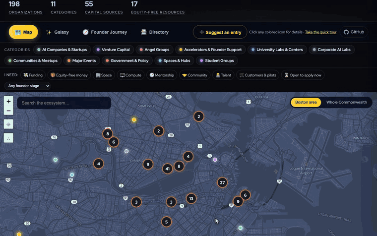

# Mass AI Atlas

[](https://github.com/holzerjm/mass-ai-atlas/actions/workflows/validate.yml)
[](data/entities.yml)
[](https://the-open-accelerator.com/ecosystem/)
[](CONTRIBUTING.md)
[](https://the-open-accelerator.com)

> ## 🏙️ This fork: 3D Lenses — a map that says how sure it is
>
> **Chart the Common Wealth hackathon, 31 Oct 2026 · Track B, "The Passage"**
>
> **▶ Live demo: [egornikot.github.io/mass-ai-atlas](https://egornikot.github.io/mass-ai-atlas/)** —
> the Map tab is ours. The standalone page is
> [atlas3d.html](https://egornikot.github.io/mass-ai-atlas/atlas3d.html), and you can try
> [an approximate, doubtful entry](https://egornikot.github.io/mass-ai-atlas/atlas3d.html?entry=liquid).
> · Pull request: [holzerjm/mass-ai-atlas#79](https://github.com/holzerjm/mass-ai-atlas/pull/79)
> · One-page brief: [docs/3d-lenses.md](docs/3d-lenses.md)
>
> ### The problem
> The Atlas already records its own doubt: approximate coordinates, verification months,
> missing stages, missing links, funders with no check size, deadlines that only say
> "rolling". None of that reached the map. A neighborhood guess looked exactly like a street
> address, and connections lived only in the Galaxy, away from the geography.
>
> ### What we added (scope)
> | | |
> |---|---|
> | **Credibility lens** | Every pin is green, amber or red, from a 0–100 reading of the brief's six doubt signals: approximate pin, verification month, no stage, no connections, funder with no check size, and a deadline that is rolling, dated or passed. We added two more signals found while building: pins that share exact coordinates, and links listed by one side only. Approximate pins are hollow rings with a halo, and older entries fade. |
> | **"Before you act"** | Each card opens with what to double-check, for example *"Get the street address from their site before you plan a visit"*. Every signal links to **the exact line** in `data/entities.yml` that supports it. |
> | **Connections on the real map** | The Galaxy's links drawn as arcs, bundled between areas so a crowd sends one thick arc instead of forty. Selecting an organization shows only its network; ← → walks through it. |
> | **3D** | Tilt and rotate the map. Columns show credibility or connections, buildings appear from street zoom, and hillshade gives relief across the whole Commonwealth. |
> | **Readable, not crowded** | Dense areas group into bubbles named after their neighborhood (Kendall Sq, Seaport…) that split as you zoom. Labels never overlap. The legend works as a show-only filter, and each lens has a short reading guide. |
> | **Day / night** | Follows the Atlas header's theme, with bluish water and green parks in both. |
> | **Keyboard & phone** | `/` search, ← → through a network, `Esc` to close; folding panel on small screens; reduced-motion support. |
>
> ### Value added
> - **For founders:** you know *before* acting which parts of an entry to double-check. The
>   confident entries stay confident, and the doubtful ones say what is doubtful and what to do
>   next.
> - **For the maintainer:** "Least certain entries" is a ready review queue, and "Suggest a
>   fix" opens the existing flag form. Nothing is written to the data without a human.
> - **For the Atlas:** the morning's probe numbers are counted live in the side panel and drawn
>   on the map. It needs no build step, adds no new data, and the data files are untouched.
>
> ### Honesty rules it follows
> It never edits data. It never presents a computed score as a verification, or an event name
> match as confirmed. It never invents an organization or a connection.
>
> **Sources:** Mass AI Atlas data (The Open Accelerator, CC BY 4.0), the Atlas events feed
> (optional), OpenFreeMap / OpenStreetMap, and AWS Open Data terrain tiles.

The living map of Massachusetts' AI ecosystem — built by the community for the community and founders, presented by
[The Open Accelerator](https://the-open-accelerator.com) (an initiative between the
MA AI Hub, Red Hat & IBM).

[](https://the-open-accelerator.com/ecosystem/)

**Four ways to explore the Massachusetts AI ecosystem:**

- 🗺️ **Map** — every VC, lab, accelerator and community across Massachusetts, now the
  3D Lenses map ([`atlas3d.html`](atlas3d.html)): how sure the atlas is about each entry,
  the Galaxy's connections on the real map, and 3D. See [docs/3d-lenses.md](docs/3d-lenses.md).
- ✨ **Galaxy** — an animated network of how the ecosystem connects (spinouts, funds, hosts)
- 🧭 **Founder Journey** — resources curated by stage, from first spark to scale
- 📇 **Directory** — full-text search with category and stage filters

Each entry's drawer says what the organization offers founders, shows when a maintainer
last verified it, and under **places to meet** lists the cafés, quick bites and quieter
spots within a five-minute walk.
Every entry and view is linkable — `?entry=csail` opens straight to an organization,
`#galaxy` to a view (there's a 🔗 Copy link button in each entry's drawer).

> **Building on this as a template?** Start with [HACKATHON.md](HACKATHON.md): setup, the
> architecture on one page, where to extend it, and what to change because it is still
> pointed at The Open Accelerator.

## Run it

It's a static site — no build step.

The hosted live page is at https://the-open-accelerator.com/ecosystem/

```bash
# locally
python3 -m http.server     # then open http://localhost:8000
```

Opening `index.html` straight from `file://` doesn't work: the page fetches its data
from `data/*.yml`, which browsers block on `file://`. Use the local server above.

The maintenance scripts (`scripts/`) need Node 20+ and the two npm dependencies
(js-yaml, Ajv): run `npm ci` once.

## Deploy

**Merging is publishing.** A GitHub Action deploys `index.html`, `atlas-data.js`,
`data/` and the map style to [the live site](https://the-open-accelerator.com/ecosystem/) on every
merge to `main` that touches them — it re-validates the data first, then rsyncs to
the server and posts a summary to the TOA Slack. (Not GitHub Pages.)

Manual fallback, from a checkout with SSH access to the server:

```bash
./scripts/sync-to-site.sh <destination>
```

The page must be served at a directory URL (`…/ecosystem/`, trailing slash) so the
relative `data/` fetches resolve.

**If the repo ever moves (or you host your own copy):** set `GH_REPO` in
`index.html` (search for `const GH_REPO`) to your `org/repo` so the in-app
**Suggest** and **Flag** buttons point at the right issue forms.

## Contribute

The atlas is community-maintained:

- **➕ Suggest an entry** — [open a suggestion](../../issues/new?template=suggest-entry.yml)
  or edit [`data/entities.yml`](data/entities.yml) and send a PR
- **🚩 Flag an entry** — [report something outdated or miscategorized](../../issues/new?template=flag-entry.yml)
  (or use the Flag button on any entry inside the atlas)

See [CONTRIBUTING.md](CONTRIBUTING.md) for the entry schema and review process.
Every PR is automatically validated by CI, and a maintainer can
hand your suggestion to the **atlas bot**, which drafts it as a pull request
(geocoded and validated) for human review — nothing publishes without a maintainer
merge.

**Maintainers** turn accepted issues and PRs into entries — see
[MAINTAINING.md](MAINTAINING.md) for the step-by-step process.

## Repo layout

```
index.html                        the app — one file of HTML/CSS/vanilla JS (Leaflet +
                                  MapLibre GL, Tailwind & web fonts via CDN; TOA-branded)
data/entities.yml                 the dataset — this is what you edit
data/categories.yml, stages.yml   the categories and founder stages
data/*.schema.yml                 JSON Schemas for the three data files
atlas-data.js                     shared loader: parses data/*.yml + validates against
                                  the schemas (used by index.html and scripts/)
package.json                      npm deps for the scripts (js-yaml, Ajv) — `npm ci`
map-style-dark.json               the dark basemap style (OpenFreeMap fiord + our grafts)
scripts/validate.js               schema + integrity validation (runs in CI and locally)
scripts/load-data.js              Node wrapper around atlas-data.js — scripts load data via this
test/data-refactor-equivalence.test.js  one-time check that data/ matches the old data.js
scripts/stale.js                  freshness report — entries longest unverified
scripts/export-csv.js             export the dataset to a spreadsheet-friendly CSV
scripts/issue-to-entry.js         the suggestion bot's form parser / entry builder
scripts/fetch-events.js           events aggregator — feeds /ecosystem/events/ weekly
scripts/build-events-page.js      assembles events/index.html (generated — see docs/)
scripts/trigger-weekly-events.sh  server-side cron that starts the weekly refresh (GitHub cron is late)
scripts/sync-to-site.sh           manual deploy fallback (CI normally deploys on merge)
.github/ISSUE_TEMPLATE/           suggest & flag forms
.github/workflows/validate.yml    CI validation + freshness summary on every data PR
.github/workflows/deploy.yml      auto-deploy to the live site + Slack notification
.github/workflows/suggest-to-pr.yml  the suggestion bot (maintainer-gated, drafts PRs)
.github/workflows/weekly-events.yml  Monday 7am ET events refresh + Slack post
docs/events-guide.md              how the events page & weekly refresh work
CONTRIBUTING.md                   entry schema & contributor workflow
MAINTAINING.md                    maintainer guide — turn issues & PRs into data/entities.yml
PROJECT_STATE.md                  architecture, decisions & backlog (start here if new)
```

## The data

The atlas is also an **open dataset** — the only maintained, human-verified dataset of
Massachusetts' AI ecosystem. Two machine-readable endpoints regenerate on every
deploy:

- **JSON** — <https://the-open-accelerator.com/ecosystem/atlas.json> — a versioned
  envelope (`schema: 1`) with all entries, categories, stages and per-category counts
- **CSV** — <https://the-open-accelerator.com/ecosystem/atlas.csv> — one row per
  organization, ready for Google Sheets (*File → Import*) or Excel (*Data → From
  Text/CSV*)

Columns/fields include name, category, location, lat/lng, website, description, tags,
founder stages and the month a maintainer last verified the entry.

To regenerate locally: `node scripts/export-json.js` and `node scripts/export-csv.js`.

**Methodology:** every entry is checked by a human against the organization's own
website plus an independent source before it ships, and re-verified on a rolling
basis (`lastVerified` records the month; entries more than a year unverified are
flagged in the app). Defunct or unverifiable organizations are removed.

**License:** the dataset is licensed under
[CC BY 4.0](https://creativecommons.org/licenses/by/4.0/) — free to use, share and
adapt with attribution to **The Open Accelerator**. Suggested citation:
*"Mass AI Atlas, The Open Accelerator — the-open-accelerator.com/ecosystem"*.

Some pin locations are approximate (neighborhood-level) and community groups move
between venues — check official sites before visiting. Curated since June 2026.

© 2026 The Open Accelerator.
